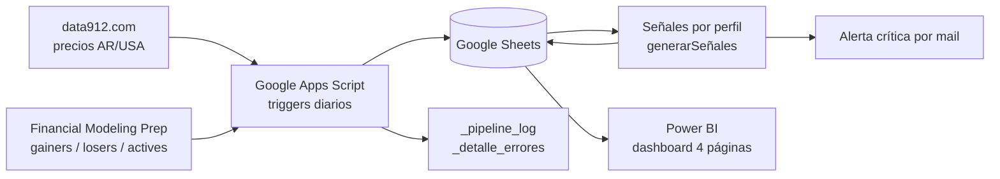

# Monitoreo de Cartera de Inversiones: pipeline de datos con Apps Script, Google Sheets y Power BI

Proyecto de **ingeniería de datos y analítica** de punta a punta: un pipeline automatizado ingesta cada día, desde dos APIs, los precios de una cartera argentina y los rankings de Wall Street, valida y registra cada corrida, transforma los datos en señales de compra/venta por perfil de inversor y los expone en un dashboard de Power BI de 4 páginas.

> **Aviso:** proyecto personal con fines de práctica en análisis de datos. Las señales son informativas y **no constituyen recomendación de inversión**.

## Qué responde este proyecto

1. ¿Cómo evoluciona mi cartera día a día y qué activos la empujan o la frenan?
2. ¿Le gano o le pierdo al mercado? (comparación contra SPY)
3. ¿Qué activos están lejos de su promedio reciente, según distintos perfiles de riesgo?
4. ¿El pipeline corre sin errores? (monitoreo técnico)

## Arquitectura

<<<<<<< HEAD
## Enfoque de ingeniería de datos
=======
Enfoque de ingeniería de datos
*   **Ingesta**: dos fuentes con formatos distintos (data912 y FMP), consumidas por API y normalizadas a un esquema común en cada corrida.
*   **Orquestación**: triggers diarios de Apps Script, con una función por etapa (ingesta, transformación, señales).
*   **Capas de datos**: históricos append-only con los datos tal como llegan (capa cruda), columnas derivadas y señales (capa transformada), y modelo semántico con medidas DAX en Power BI (capa de consumo). Es un equivalente conceptual de la arquitectura medallón.
Calidad de datos: validación de estructura de la respuesta, de símbolos sin coincidencia y de precios inválidos, con descarte del ítem sin cortar el resto del proceso.
*   **Observabilidad**: log por corrida (_pipeline_log) y detalle por ítem fallido (_detalle_errores), ambos conectados al dashboard (página 4).
*   **Resiliencia**: reintentos con espera progresiva ante fallos transitorios de las APIs.
*   **Gestión de secretos**: la API key vive en las propiedades del script, nunca en el código, y las URLs se registran sin el query string para no filtrarla en los logs.
*   **Contratos de datos**: esquema documentado por hoja y una convención única de unidades (fracciones decimales), definida después de detectar inconsistencias entre fuentes (ver Decisiones y aprendizajes).
>>>>>>> 5137f900a41424e6e6ebf912b527c16d9ff1992b

- **Ingesta:** dos fuentes con formatos distintos (data912 y FMP), consumidas por API y normalizadas a un esquema común en cada corrida.
- **Orquestación:** triggers diarios de Apps Script, con una función por etapa (ingesta, transformación, señales).
- **Capas de datos:** históricos *append-only* con los datos tal como llegan (capa cruda), columnas derivadas y señales (capa transformada), y modelo semántico con medidas DAX en Power BI (capa de consumo). Es un equivalente conceptual de la arquitectura medallón.
- **Calidad de datos:** validación de estructura de la respuesta, de símbolos sin coincidencia y de precios inválidos, con descarte del ítem sin cortar el resto del proceso.
- **Observabilidad:** log por corrida (`_pipeline_log`) y detalle por ítem fallido (`_detalle_errores`), ambos conectados al dashboard (página 4).
- **Resiliencia:** reintentos con espera progresiva ante fallos transitorios de las APIs.
- **Gestión de secretos:** la API key vive en las propiedades del script, nunca en el código, y las URLs se registran sin el query string para no filtrarla en los logs.
- **Contratos de datos:** esquema documentado por hoja y una convención única de unidades (fracciones decimales), definida después de detectar inconsistencias entre fuentes (ver *Decisiones y aprendizajes*).

## Stack

- **Recolección y automatización:** Google Apps Script (JavaScript), triggers diarios
- **Almacenamiento:** Google Sheets
- **Fuentes:** [data912.com](https://data912.com) (sin autenticación) y [Financial Modeling Prep](https://financialmodelingprep.com) (API key, plan gratuito)
- **Visualización:** Power BI (Power Query + DAX)

## Fuentes de datos

| Fuente | Endpoints | Se usa para |
|---|---|---|
| data912 | `arg_cedears`, `arg_stocks`, `usa_adrs`, `usa_stocks`, `arg_bonds` | Precios de la cartera (CEDEARs, acciones locales y de EE.UU., bono) |
| FMP | `/stable/biggest-gainers`, `/biggest-losers`, `/most-actives` | Top 10 diario de Wall Street por categoría |

La API key de FMP se guarda en las propiedades del script (`PropertiesService`), no en el código.

## Modelo de datos (hojas)

| Hoja | Columnas |
|---|---|
| `Mi_Portafolio_Manual` | simbolo, cantidad, tipo_instrumento |
| `Mi_Portafolio_Historico` | fecha_hora, simbolo, tipo_instrumento, cantidad, precio_actual, moneda, valorizado, variacion_acumulada_pct |
| `Wall_Street_Top_Historico` | fecha_hora, categoria, simbolo, precio, variacion_pct |
| `Reglas_Señales` | perfil, ventana_dias, umbral_compra_pct, umbral_venta_pct |
| `Señales_Portafolio` | fecha_hora, simbolo, perfil, precio_actual, promedio_movil, variacion_pct, señal, ventana_completa |
| `_pipeline_log` | fecha_hora, funcion, fuente, filas_procesadas, estado, detalle |
| `_detalle_errores` | fecha_hora, funcion, simbolo, tipo_error, detalle |

<<<<<<< HEAD
## Scripts

| Función | Qué hace |
|---|---|
| `actualizarPreciosCartera()` | Lee la cartera, busca cada símbolo en su fuente según el tipo de instrumento y guarda precio y valorizado en el histórico. |
| `actualizarTopInversiones()` | Trae los 10 primeros de gainers, losers y most actives de FMP y los guarda en el histórico. |
| `backfillVariacionAcumulada()` | Calcula la variación acumulada de cada símbolo contra su primer precio registrado. |
| `generarSeñales()` | Compara el último precio contra el promedio móvil de cada perfil y emite la señal. Envía un mail si algún activo supera el umbral crítico. |
| `fetchConReintentos()` | Reintentos con espera progresiva ante fallos transitorios de las APIs. |
=======
La función actualizarPreciosCartera() lee la cartera, busca cada símbolo en su fuente según el tipo de instrumento y guarda precio y valorizado en el histórico.
Por su parte, actualizarTopInversiones() trae los 10 primeros de gainers, losers y most actives de FMP y los guarda en el histórico.
Luego, backfillVariacionAcumulada() calcula la variación acumulada de cada símbolo contra su primer precio registrado.
La función generarSeñales() compara el último precio contra el promedio móvil de cada perfil y emite la señal. Envía un mail si algún activo supera el umbral crítico. Finalmente, fetchConReintentos() es uan función que genera reintentos con espera progresiva ante fallos transitorios de las APIs.
>>>>>>> 5137f900a41424e6e6ebf912b527c16d9ff1992b

### Manejo de errores

- Reintentos con espera creciente en cada llamada a una API.
- Validación de estructura de la respuesta (`esArrayValido`), de símbolos sin coincidencia y de precios inválidos (nulos o ≤ 0).
- Cada corrida deja una fila en `_pipeline_log` (`OK`, `OK_CON_ERRORES` o `ERROR`) y cada ítem fallido queda detallado en `_detalle_errores`.

## Señales por perfil

La señal compara el último precio con el **promedio móvil** de la ventana del perfil:

- variación ≤ umbral de compra → `CONSIDERAR_COMPRA`
- variación ≥ umbral de venta → `CONSIDERAR_VENTA`
- en otro caso → `MANTENER`

| Perfil | Ventana (días) | Umbral compra | Umbral venta |
|---|---|---|---|
| conservador | 30 | −8% | +8% |
| moderado | 15 | −5% | +5% |
| agresivo | 7 | −3% | +3% |
| alerta_critica | 15 | −15% | +15% |

`alerta_critica` no emite señal: dispara un mail único con todos los activos que se alejaron más de ±15% de su promedio. La columna `ventana_completa` indica si ya hay histórico suficiente para la ventana del perfil.

## Dashboard (Power BI)

| Página | Contenido |
|---|---|
| 1. Resumen ejecutivo | KPI de rendimiento general, línea temporal, anillo por tipo de instrumento y tabla de detalle, con filtro por símbolo. |
| 2. Portafolio vs. Wall Street | Top 10 por categoría (active / gainer / loser), rendimiento por activo, KPI de diferencia vs. SPY y línea comparativa portafolio–SPY. |
| 3. Señales | Gráfico combinado precio vs. promedio móvil de 15 días y tabla de señales con semáforo. |
| 4. Pipeline log | KPIs (filas, corridas, errores), volumen diario por función y tabla de auditoría. |

> Agregá capturas en `/docs/img/` y enlazalas acá: ``

## Decisiones y aprendizajes

- **Unidades consistentes:** FMP devuelve `changesPercentage` en puntos porcentuales (`50.28` = 50,28%). Al formatear la columna como porcentaje, Sheets lo multiplicaba por 100 y aparecían losers de −6.492%, un valor imposible. Se corrigió dividiendo por 100 al guardar y se normalizó el histórico existente con una función de una sola ejecución. **Regla del proyecto:** los porcentajes se guardan como fracción y el formato se aplica en la capa de presentación.
- **Configuración regional en Power BI:** las hojas usan coma decimal (es-AR) y Power BI las leyó como separador de miles, inflando los valores. Se resolvió importando con configuración regional *Español (Argentina)*.
- **Benchmark:** el promedio de gainers/losers del día no es el rendimiento del mercado (son extremos seleccionados por su movimiento), por lo que la comparación se hace contra **SPY**.
- **Clasificación de instrumentos:** un CEDEAR es un certificado de una empresa *extranjera*, por eso las empresas argentinas se clasifican como `accion_local_ar`.

## Limitaciones conocidas

- La cartera se carga a mano; el histórico cubre aproximadamente un mes (≈1.400 filas, 69 corridas al momento de esta versión).
- El umbral de cada perfil es un porcentaje fijo, sin ajustar por la volatilidad de cada activo: activos de baja volatilidad (SPY, bonos) casi nunca emiten señal y los volátiles emiten con frecuencia.
- Es una señal de reversión a la media, sin filtro de tendencia: un precio bajo su promedio puede ser una oportunidad o una caída sostenida.
- Los fines de semana y feriados repiten el último precio y pesan de más en el promedio móvil.
- El rendimiento del portafolio es un promedio simple entre activos, no ponderado por monto.
- En el bono, el precio puede moverse por pagos de cupón y no solo por el mercado.
- El SPY de la cartera es el CEDEAR en pesos, por lo que la comparación incluye el efecto del tipo de cambio.
- El pipeline no es idempotente: si una función se ejecuta dos veces el mismo día, agrega filas duplicadas en el histórico.
- Google Sheets funciona como almacenamiento y tiene límites de volumen y de tiempo de ejecución; para más histórico o más fuentes habría que migrar a una base de datos o un data warehouse.

## Próximos pasos

- [ ] Medir las señales en desvíos estándar (z-score) para normalizar por volatilidad.
- [ ] Deduplicar precios por día antes de calcular el promedio móvil.
- [ ] Hacer la ingesta idempotente (clave por símbolo y fecha, para evitar duplicados al re-ejecutar).
- [ ] Agregar pruebas automáticas de calidad de datos (rangos de variación, nulos, duplicados) antes de publicar al dashboard.
- [ ] Migrar el almacenamiento a una base de datos o warehouse y orquestar con una herramienta dedicada.
- [ ] Reemplazar la carga manual de la cartera por consultas a la API de IOL.
- [ ] Reporte diario por mail con la variación de cada activo.
- [ ] Rendimiento del portafolio ponderado por valorizado.

## Cómo reproducirlo

1. Creá un Google Sheet con las hojas del modelo de datos y cargá `Reglas_Señales` y `Mi_Portafolio_Manual`.
2. En *Extensiones → Apps Script*, pegá los scripts de `/src`.
3. Guardá tu API key de FMP en las propiedades del script con el nombre `FMP_API_KEY`.
4. Configurá triggers diarios para `actualizarPreciosCartera`, `actualizarTopInversiones` y `generarSeñales`.
5. Conectá Power BI al Sheet. Al importar, usá configuración regional *Español (Argentina)* para los campos numéricos.

## Autor

**Manuel Martínez** · Data Analyst
[LinkedIn](#) · [GitHub](#)